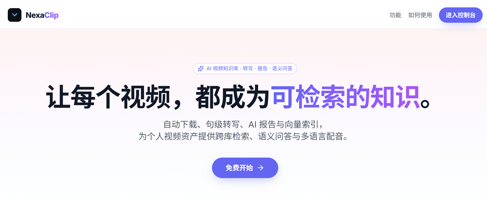
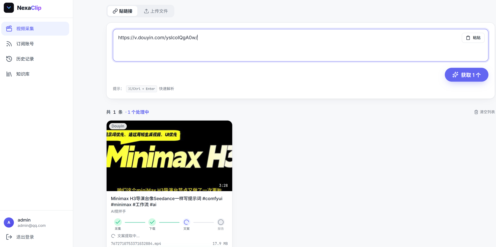
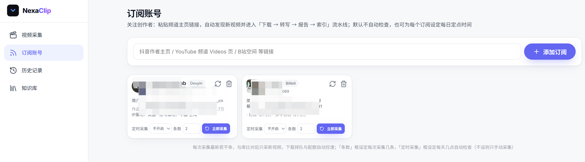
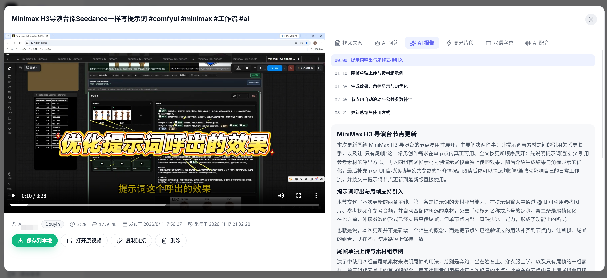
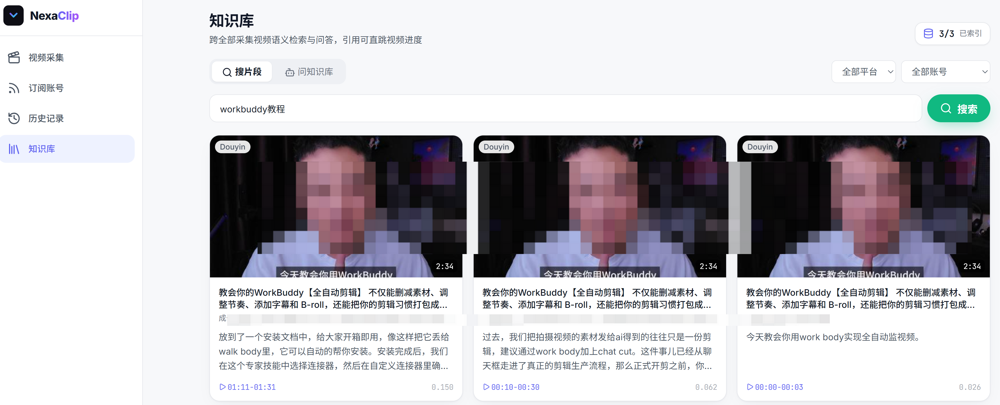

# NexaClip

**把视频变成你的知识库。** 粘贴链接或上传文件，自动完成下载 → 句级转写 → AI 图文报告 → 向量索引；之后你可以跨库检索问答、在时间轴上标注高光、把外语视频翻译配音成"母语生肉"。

自托管的个人音视频知识管理：FastAPI + Vue 3 + SQLite（sqlite-vec），AI 能力全部走千流云 OpenAI 兼容网关（一把 key），无 GPU、无本地大模型依赖。

[](LICENSE)


## 界面预览

**落地页**



**视频采集页面**：粘贴链接或批量导入，自动完成下载 → 句级转写 → AI 报告 → 向量索引



**订阅账号页面**：关注创作者主页，每日定点自动枚举新视频并入库



**采集卡片详情**：播放器 + 时间轴高光 + 文案 / 问答 / 报告 / 字幕 / 配音



**检索与知识库**：跨视频混合召回，答案引用可直跳原视频秒数



## 功能一览

| | 能力 | 说明 |
| --- | --- | --- |
| 📥 | **多源采集** | 抖音 / B 站（链接、BV 号、b23.tv 短链）/ yt-dlp 上千站点 / 本地上传（DRM、私密视频的兜底）；贴链接即自动下载，批量并发 |
| 🔄 | **订阅自动采集** | 关注创作者主页，每日定点自动枚举新视频并入库（下载→转写→报告→索引全链路） |
| 📝 | **句级转写** | ASR 产出带时间戳的逐句文案，点任意一句跳到视频对应进度；自动检测源语言 |
| 🤖 | **AI 图文报告** | 大纲 + 章节时间轴 + Markdown 报告，两分钟长文速览 |
| ️ | **知识库问答** | 向量 + 关键词混合召回、RRF 融合、重排；跨视频问答与单视频问答，**答案引用可点击直跳原视频秒数** |
| ✨ | **时间轴高光** | LLM 标注金句/冲突/核心概念/转折点，时间轴可视化；选中片段可导出（合并 mp4 或分条 zip） |
| 🌐 | **翻译与配音** | 外语视频译成中/英：双语 srt、画面烧录译文字幕、千流云 TTS 自然语速配音替换原音轨 |
| 🔐 | **多用户隔离** | 全局共享库按用户归属（同一视频只下载一次），配额与并发闸 |

## 快速开始

### Docker

```bash
# 构建上下文必须是仓库根（Dockerfile 里 COPY backend/...）
docker build -f docker/Dockerfile -t nexaclip .
docker run -d -p 7860:7860 -v $PWD/data:/app/data --env-file backend/app/.env nexaclip
```

更细的部署说明（反向代理、持久卷、静态托管）见 [docker/README.md](docker/README.md)。

### 本地开发

```bash
# 后端（Python ≥3.12，uv 管理）
cd backend && uv sync
cp app/.env.example app/.env    # 填 QL_KEY（千流云）等，见下
cd app && ../.venv/bin/python main.py   # 默认端口见 BACK_END_PORT

# 前端（Node ≥20，pnpm）
cd frontend && pnpm install && pnpm dev # Vite proxy 转发 /api 到后端
```

打开 `http://localhost:5173`，注册即用。API 交互文档：`http://<后端>/docs`。

### 关键环境变量（`backend/app/.env`）

| 变量 | 说明 |
| --- | --- |
| `QL_KEY` | 千流云 key——chat / embedding / rerank / ASR / TTS 全链路共用一把 |
| `JWT_SECRET_KEY` | 务必固定，随机值会令每次重启全员掉线 |
| `SUPER_ADMIN_EMAIL/PASSWORD` | 首启自动创建管理员 |
| `BACK_END_PORT` | 后端端口（默认 7860） |
| `DOWNLOAD_CONCURRENCY` / `USER_QUOTA_*` | 下载并发闸与配额 |

反爬 cookies 一律用浏览器扩展「Get cookies.txt LOCALLY」登录目标站后导出的 Netscape txt，放到 `backend/app/data/cookies/` 下对应文件即可：`www.youtube.com_cookies.txt`、`www.douyin.com_cookies.txt`、`www.bilibili.com_cookies.txt`（路径可用 `.env` 的 `YOUTUBE_COOKIES` / `DOUYIN_COOKIES` / `BILIBILI_COOKIES` 覆盖）。

## 项目结构

```
backend/app/
├── core/          # 渠道(douyin/bilibili/ytdlp)、转写、AI 报告、RAG、高光、翻译配音、Range、调度…
├── models/        # User / Video(全局媒体库) / UserVid / VideoChunk / Subscription / UserSub
├── controllers/   # 采集编排与全链路状态机
├── api/v1/        # base(用户) / media(采集·知识库·订阅·高光·翻译) / system
└── data/          # db.sqlite3 · store/(成品与派生产物) · work/ · logs/
frontend/src/
├── views/console/ # 采集 / 采集记录 / 知识库 / 订阅
└── components/    # VideoDetailModal（播放器+时间轴高光+文案/问答/报告/高光/字幕/配音 6 tab）等
```

## 已知限制

- **平台反爬会变**：抖音 Web detail 接口要求 SecSDK 签名（缺失时 403 `Blocked by ArgusSecurityPlugin ...`）；B 站 API 要求访客指纹 `buvid3`（缺失时 412 `request was banned`）。实现与换盐步骤见 [docs/douyin-secsdk.md](docs/douyin-secsdk.md)。
- **cookies 需自备，且会过期**：按导出文件自带的过期时间戳，抖音 `sessionid` 约 **60 天**、B 站 `SESSDATA` 约 **90 天**；但平台风控可提前作废（异地登录、改密码、触发验证）。失效表现为 403 / 412 或「未登录」文案，重新导出覆盖即可。
- **DRM / 私密 / 会员视频**：不绕过 DRM，请用「本地上传」兜底。
- **AI 能力依赖千流云**：未配置 `QL_KEY` 时，转写 / 报告 / 问答 / 配音不可用。

## 技术栈

**后端** FastAPI · Tortoise ORM · SQLite + sqlite-vec + FTS5 · APScheduler · yt-dlp / f2 / B 站 API · FFmpeg · httpx
**前端** Vue 3 · Vite · Pinia · UnoCSS（无组件库）
**AI** 千流云：chat · embedding · reranker · asr-pro 转写 · tts-flash 配音

## 参与贡献

欢迎 issue / PR。动代码前请先看 [docs/architecture.md](docs/architecture.md)。

- **环境**：后端 Python ≥3.12 + uv；前端 Node ≥20 + pnpm。
- **规范**：后端 `cd backend && uvx ruff check app && uvx ruff format app`；前端 `cd frontend && pnpm lint && pnpm build`。
- 一个 PR 只做一件事；涉及采集渠道 / 风控的改动请附实测结果。
- **不要提交** `.env`、cookies（`data/cookies/`）、任何密钥，或 `data/` 下的数据库与产物。
- 安全问题请走仓库的 **Security → Report a vulnerability**（私密通告），不要开公开 issue；日志贴出来前先脱敏（cookie / token / 带签名的地址）。

## 开源协议

本项目以 **GNU AGPL-3.0** 发布，全文见 [LICENSE](LICENSE)。Copyright (c) 2026 NexaClip contributors.

你可以自由使用、修改、自托管，包括商业内部使用；但若把修改后的版本**作为网络服务提供给他人使用**，必须按 AGPL-3.0 公开修改后的完整源码。

## 免责声明

本项目仅供个人学习与合法用途。请遵守目标平台的服务条款与著作权法规，勿用于批量抓取、内容盗版或商业分发。项目作者不对使用者的行为及后果承担责任。
